# Avant-Garde Skills Suite

<p align="center">
  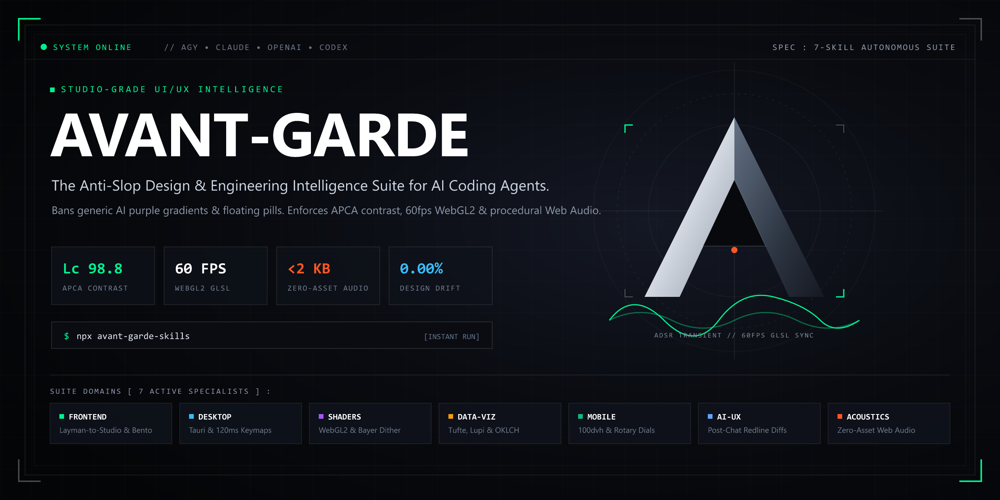
</p>

[](LICENSE)
[](package.json)
[](package.json)
[](package.json)

> **The Studio-Grade UI/UX Intelligence Suite for AI Coding Agents.**  
> Compatible with **Google Gemini CLI / Antigravity (AGY)**, **Claude Code**, **OpenAI Agents**, and **Codex**.

Replaces generic "AI slop" — purple/indigo gradients, floating pastel pill badges, template monoculture (the copy-pasted hero + 3 cards + 1 chart formula), and empty chatbot boxes — with **authentic domain archetypes, APCA contrast, aspect-correct WebGL2 shaders, zero-asset Web Audio synthesis, and multi-screen design lock**.

---

## ⚡ Quick Start (Instant Installation via `npx`)

Install all 7 skills directly into your detected agent directories (`~/.gemini/skills`, `~/.claude/skills`, `~/.agents/skills`, `~/.codex/skills`) with a single command:

```bash
# Direct run via npm package
npx avant-garde-skills

# Or run directly from GitHub without installing anything
npx github:Gabriel-Programacoes/avant-garde-skills
```

### Install Specific Skills or Target a Specific Agent
```bash
# Install only frontend and AI-UX to Claude Code
npx avant-garde-skills install avant-garde-frontend avant-garde-ai-ux --agent claude

# Install all skills into a custom folder or project repo
npx avant-garde-skills install --dest ./my-project/.agent/skills

# List all available skills and descriptions
npx avant-garde-skills list
```

---

## 🥊 The Proof: Before vs. After (Same Exact Prompt)

**Prompt given to the AI:**  
> *"Create a modern, high-tier private wealth and real-world asset (RWA) allocation workbench with yield analytics, portfolio waterfall breakdown, and secondary market liquidity depth."*

### ❌ Without Avant-Garde (Typical AI Slop Baseline)
*Inter font everywhere, generic purple/indigo blur blobs, centered marketing hero with glowing gradient text, 3 identical metric cards, pastel pill badges with 9999px radius, static dead SVG, no physical presence.*

<p align="center">
  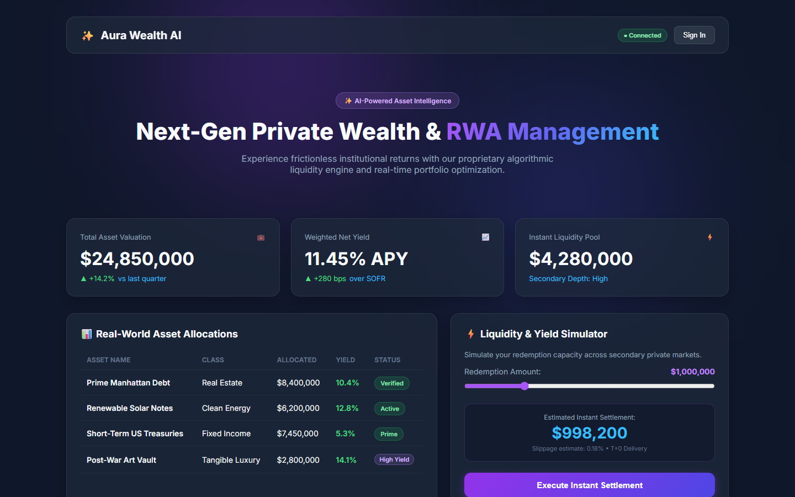
</p>

### ✅ With Avant-Garde Skills (Institutional Command Workbench)
*Architectural Obsidian & Titanium terminal. Zero marketing fluff hero. Real-time global market ribbon with active UTC financial clocks (Zürich / NYC), asymmetric 3-panel workbench (310px waterfall ledger | 1fr continuous orderbook & macro stress matrix | 370px capital liquidation desk), `Instrument Serif` + `Plus Jakarta Sans` + `JetBrains Mono` (`tabular-nums`), zero pastel pill badges, stepped physical sliders, and zero-asset procedural Web Audio API acoustic feedback.*

<p align="center">
  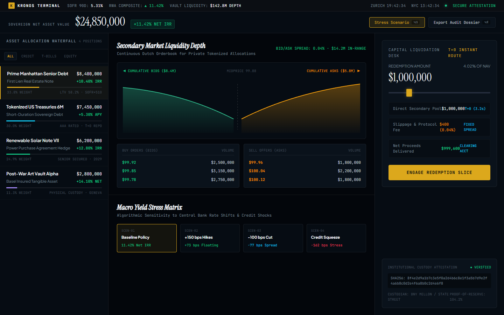
</p>

| Dimension | Without Avant-Garde (Default LLM) | With Avant-Garde Suite |
|---|---|---|
| **Structural Archetype** | Generic SaaS landing page template disguised as an app | Institutional Multi-Panel Trading & Capital Allocation Terminal |
| **Page Anatomy** | Centered Hero + 3 equal cards + dummy table | Top status ribbon + 3-column asymmetric cockpit (Ledger \| Orderbook \| Desk) |
| **Color System** | Generic RGB/Tailwind `#0f172a` + purple-indigo gradient | Perceptually uniform OKLCH obsidian ground + titanium gold & emerald accents |
| **Typography** | Default `Inter` across all headings, numbers, and labels | Expressive `Instrument Serif` + `Plus Jakarta Sans` + `JetBrains Mono` |
| **Status / Tags** | Pastel pill/badge bubbles (`border-radius: 9999px`) | Architectural naked monospace ledgers, bracketed attestation tags `[AUDITED]` |
| **Numeric Telemetry** | Plain text that jitters during updates | Fixed `tabular-nums` with smooth 60fps `requestAnimationFrame` tweening |
| **Orderbook & Analytics** | Static line placeholder | Real-time SVG cumulative bid/ask depth curve + live macro stress matrix |
| **Sensory Feedback** | Zero sound, zero tactile presence | Zero-asset Web Audio API acoustic transients (`<1KB`) + physical detents |
| **Multi-Screen** | Amnesia & Design Drift (Screen 2 breaks Screen 1) | Automatic `.ui-design-lock.json` contract + component registry |

---

## 🏛️ The 7 Avant-Garde Skills

| Skill | Role & Domain | Signature Mechanics | Benchmark Eval |
|---|---|---|---|
| [**`avant-garde-frontend`**](avant-garde-frontend/SKILL.md) | Editorial Web, SaaS & E-Commerce | Layman-to-Studio Translator, APCA (`Lc`) contrast, Structural Archetype Diversity, Asymmetric Bento grids. | [Lumina Atelier](evals/layman-clinic-lumina) |
| [**`avant-garde-desktop`**](avant-garde-desktop/SKILL.md) | Hardware Instruments & Desktop Software (Tauri/Electron) | Pointer-locked scrubbers, sub-120ms keyboard keymaps, custom window chrome, BroadcastChannel multi-window. | [HexRack Studio](evals/desktop-hexrack) |
| [**`avant-garde-motion-shaders`**](avant-garde-motion-shaders/SKILL.md) | 60fps WebGL2 & Procedural Shaders | Aspect-correct GLSL `#version 300 es`, Bayer dithering, liquid domain warp, spring physics, Lenis/GSAP. | [Aether Stage](evals/motion-shaders-aether) |
| [**`avant-garde-data-viz`**](avant-garde-data-viz/SKILL.md) | Editorial Journalism & High-Frequency Telemetry | Tufte & Lupi craft, perceptual OKLCH color scales, ridgeline distributions, small multiples, 60fps Canvas/SVG. | [Pelagic Observatory](evals/data-viz-observatory) |
| [**`avant-garde-mobile-tactile`**](avant-garde-mobile-tactile/SKILL.md) | Pocket Instruments & Mobile PWAs | Thumb-zone ergonomics, 100dvh safe-area shells, rotary dials, spring-snapping bottom sheets, haptic feedback. | [Lux Rangefinder](evals/mobile-tactile-field) |
| [**`avant-garde-ai-ux`**](avant-garde-ai-ux/SKILL.md) | Post-Chat Generative Workbenches | Inline semantic diffs (`<del>`/`<ins>`), bidirectional citation matrices, transparent tool-call trace (`tabular-nums`). | [Veritas Clause](evals/ai-ux-veritas) |
| [**`avant-garde-sonic-haptics`**](avant-garde-sonic-haptics/SKILL.md) | Procedural Acoustics & Micro-Haptics | 100% zero-asset Web Audio API synthesis (`<2KB`), physical solenoid/ceramic transients, ADSR oscilloscope. | [Tonwerk T-1000](evals/sonic-haptics-atelier) |

---

## 🎯 Four Architectural Breakthroughs

### 1. Structural Archetype Diversity (Anti-Template Monoculture)
Bans the repetitive template formula: `Hero with Big Title -> 3 Equal KPI Cards -> 1 Line Chart -> 1 Simulator below`.  
Forces the agent to autonomously select an authentic structural archetype:
- **Institutional Command Desk (Bloomberg / Aladdin)**: Zero marketing fluff hero. Real-time status ribbon, asymmetric multi-column workbench, orderbook depth, direct execution desk.
- **Asymmetric Split Dossier (Perplexity Pro / Substack)**: 40/60 persistent inspection canvas on left, continuous reactive reading/evidence feed on right.
- **Tactile Modular Deck (Teenage Engineering / Braun)**: Vertically stacked hardware rack, analog rotaries, stepped sliders, 100dvh safe-area pocket layout.
- **Spatial Canvas & Contextual Inspector (Figma / Linear)**: Infinite/bounded canvas, floating minimal dock, contextual property inspectors.
- **Editorial Longform Investigation (NYT / The Pudding)**: Extreme typography scale, multi-column reading rhythm, inline Tufte margin plots.

### 2. The Layman-to-Studio Intent Translator
Non-technical users typically do not speak frontend jargon like *"refractive optical acrylic"* or *"APCA Lc 98.8 contrast"*. When a user asks:
> *"Make a clean, beautiful, and modern interface for my system"*

The skill **never** punishes the user with generic purple AI templates or harsh, dark brutalism. It autonomously maps layperson words to studio archetypes:
- **"Clean, beautiful, modern"** → Sunlit Architectural Daylight, warm travertine alabaster, `Instrument Serif` + `Plus Jakarta Sans`, asymmetric bento layout, interactive hero simulator.
- **"Elegant and sophisticated"** → Editorial Atelier / Quiet Luxury, hairline 1px borders, deep espresso or creamy limestone, generous negative space.
- **"Fast / practical productivity software"** → Linear/Cron/Stripe-style productivity monolith, `tabular-nums` readouts, instant keyboard navigation.

### 3. Multi-Screen Continuity & Component Registry (`design-lock.mjs`)
Solves the #1 failure mode of LLM coding in multi-page applications: **Design Drift** and **Component Amnesia**.
- **Screen 1:** Automatically extracts reusable primitives (`Calendar`, `NavPill`, `SegmentedSwitch`, `Modal`, `Scrubber`) into `components/ui/<Name>.tsx` and locks the design contract in `.ui-design-lock.json`.
- **Screen 2..N:** Locks 100% of the CSS tokens, fonts, and radii from Screen 1. When the user asks for a calendar on Screen 20, the agent queries `design-lock.mjs find <dir> calendar` and imports the existing component rather than creating a duplicate.
- **Auditor Verification:** Automatically fails any screen with `token-drift` or `duplicate-primitive`.

### 4. The 3 Anti-Slop Computational Laws
Enforced automatically by `audit-ui.mjs`, `audit-ai-ux.mjs`, and `audit-sonic.mjs`:
1. **No AI Gradient Law (`anti-slop-gradient`):** Zero generic `from-purple-500 to-indigo-600` Tailwind gradients. Uses perceptual OKLCH color spaces.
2. **No Pastel Pill Badge Soup (`anti-slop-pill-badge`):** Completely bans floating pastel `border-radius: 999px` capsules for status, risk, or category tags. Enforces architectural 1px hairline dividers, naked monospace text, and 6px solid geometric indicators (`■`).
3. **The Living Motion Law (`static-dead-ui`):** Rejects any screen that looks like a static PDF. Enforces staggered entrance choreography (`@keyframes`), Web Animations API state morphing, real-time `requestAnimationFrame` counters, and tactile `:hover`/`:active` physics with `@media (prefers-reduced-motion: reduce)` compliance.

---

## 📸 Benchmark Visual Gallery

Every skill in the suite is backed by runnable, audited benchmark implementations in `evals/`:

### Sunlit Architectural Daylight & Reusable Calendar (`avant-garde-frontend`)
*Evaluated on Lumina Atelier Dermatology (Screen 1 → Screen 2 continuity)*  
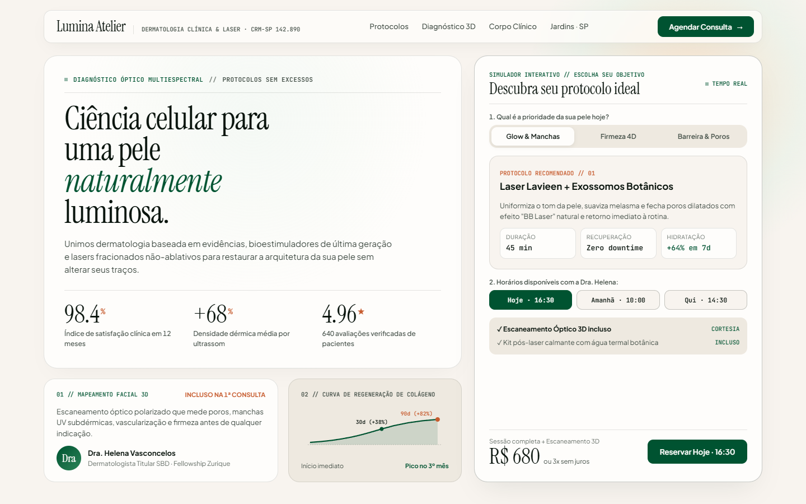  
*Screen 2: Reusing LuminaCalendar & LuminaNavPill with zero design drift:*  
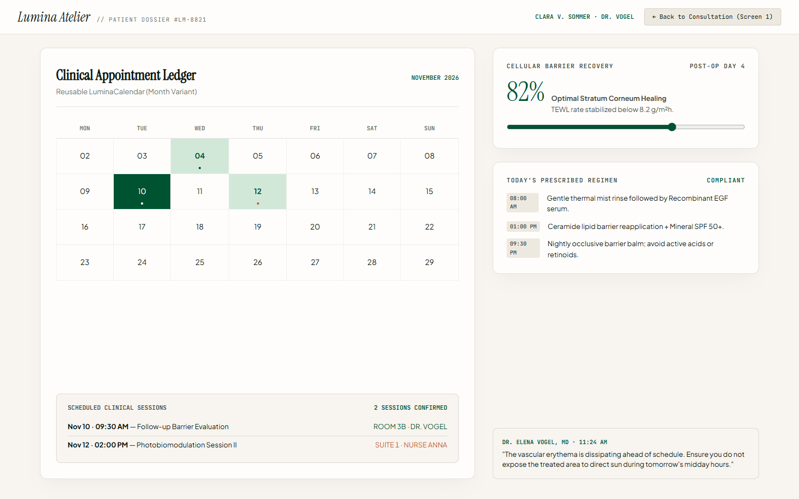

### Post-Chat Redline & Epistemic Grounding (`avant-garde-ai-ux`)
*Evaluated on Veritas Clause Contract Workbench (No pill badges, inline semantic diffs, tool trace):*  
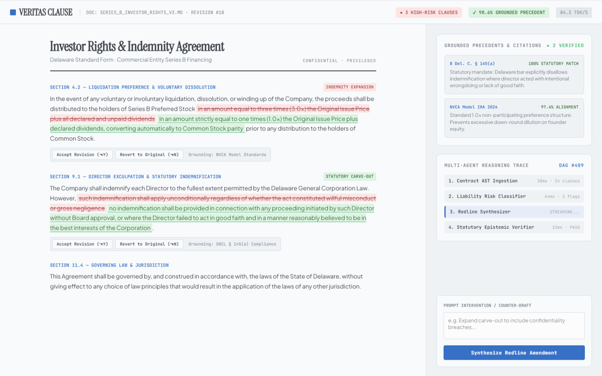

### Zero-Asset Procedural Acoustics & ADSR Scope (`avant-garde-sonic-haptics`)
*Evaluated on Tonwerk T-1000 Braun Industrial Sound Laboratory:*  
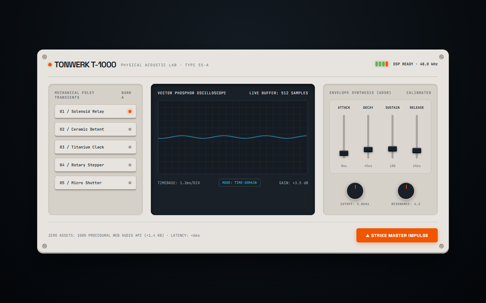

### Hardware Instrument & Multi-Pane Studio (`avant-garde-desktop`)
*Evaluated on HexRack Studio:*  
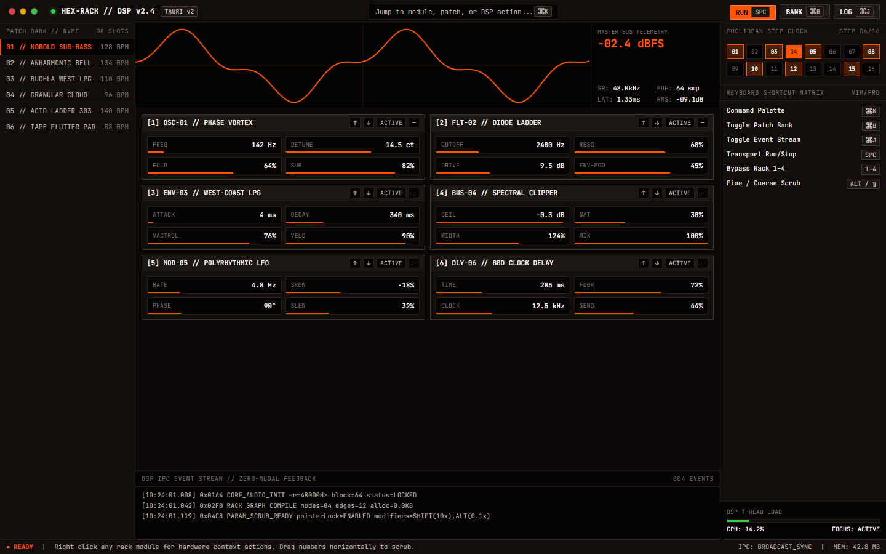

### 60fps WebGL2 Aspect-Correct Procedural Shaders (`avant-garde-motion-shaders`)
*Evaluated on Aether Shader Stage:*  
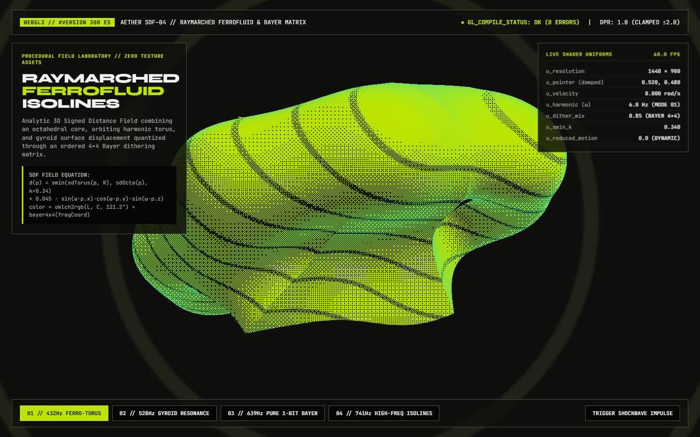

### Editorial Telemetry & Scientific Observatory (`avant-garde-data-viz`)
*Evaluated on Pelagic Observatory:*  
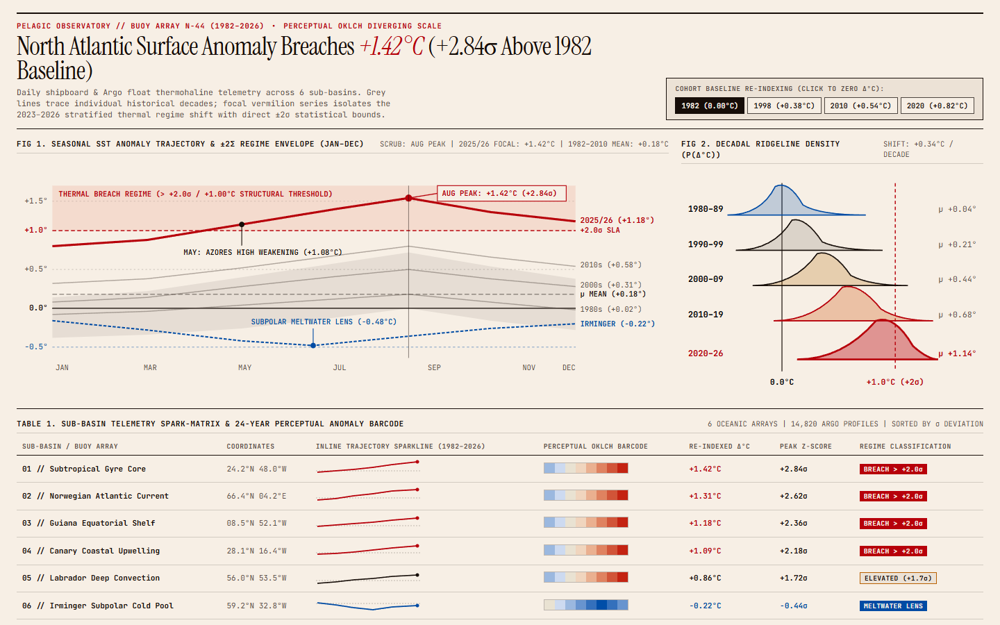

### Pocket Instrument & Rotary Dial (`avant-garde-mobile-tactile`)
*Evaluated on Lux Rangefinder (100dvh safe-area):*  
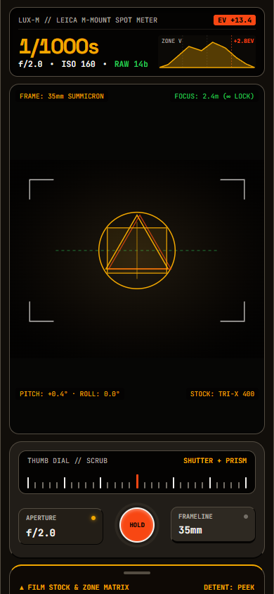

---

## 🛠️ CLI Reference

The suite comes with standalone zero-dependency CLI tooling:

```bash
# Audit any project folder against Anti-Slop, JSX, and Living Motion rules:
npx avant-garde-skills audit ./src --mode web
npx avant-garde-skills audit ./src --mode desktop

# Inspect or verify multi-screen design lock:
npx avant-garde-skills lock status ./src
npx avant-garde-skills lock scan ./src --name "my-app" --archetype "editorial-atelier" --write
npx avant-garde-skills lock find ./src "calendar"
npx avant-garde-skills lock verify ./src

# Sync skills directly to all AI agents:
npm run sync
```

---

## 📦 How to Publish to GitHub & npm

### 1. Push to GitHub
```bash
git remote add origin https://github.com/Gabriel-Programacoes/avant-garde-skills.git
git branch -M main
git push -u origin main
```

### 2. Publish to npm (for `npx avant-garde-skills`)
```bash
npm login
npm publish --access public
```

---

## 📄 License

MIT © 2026 Gabriel-Programacoes. Free to use, adapt, and build studio-grade software.
